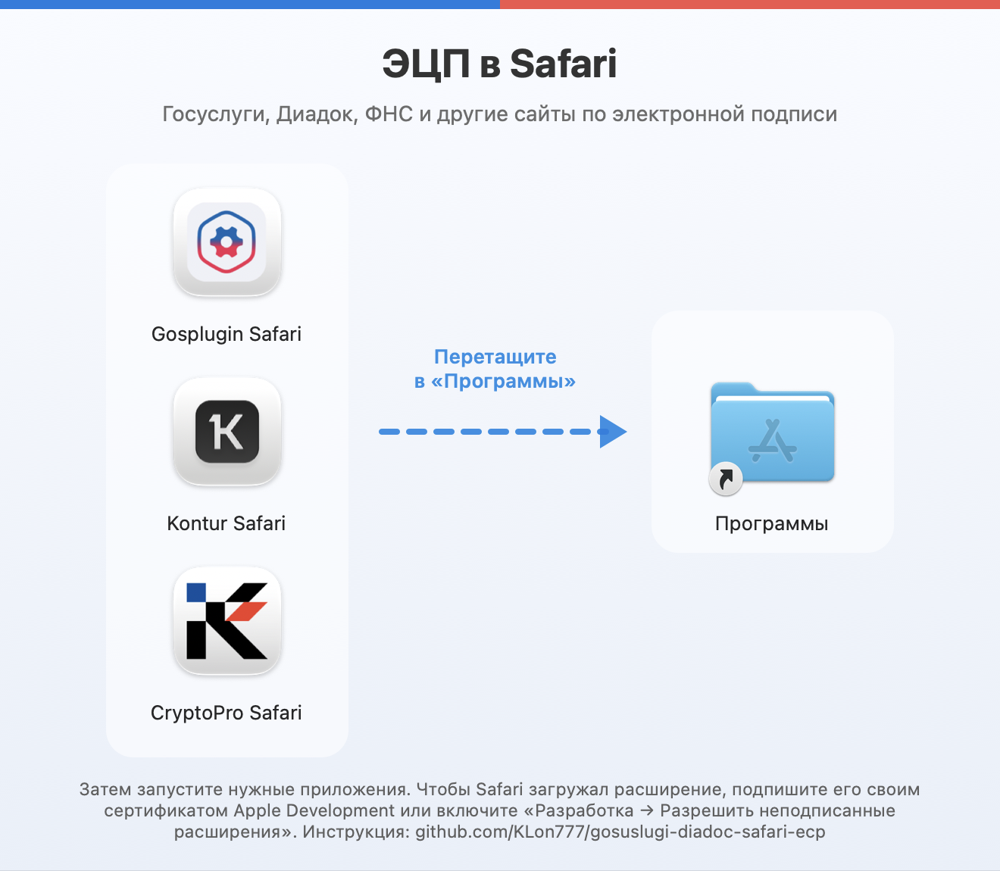
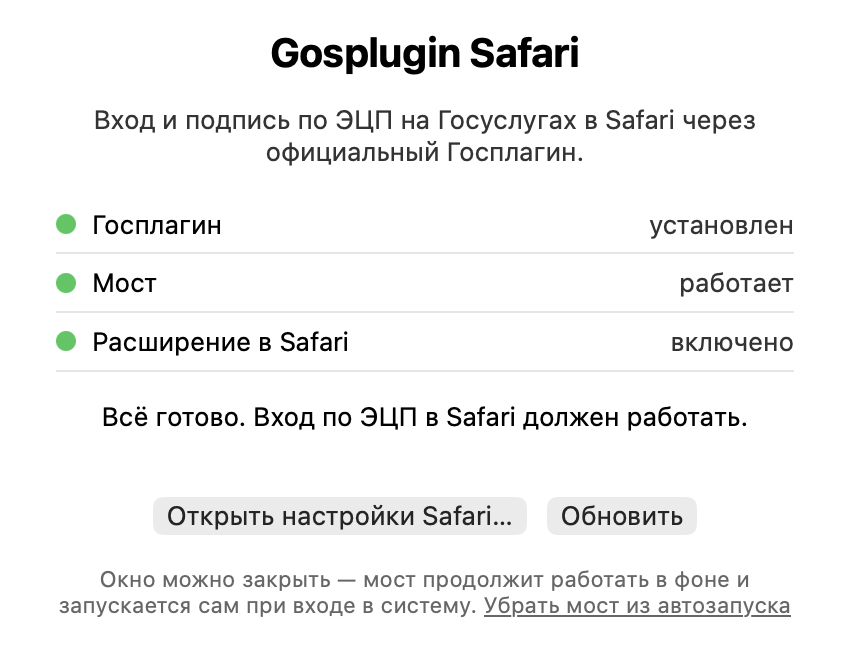
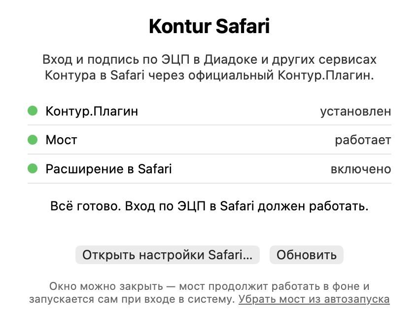
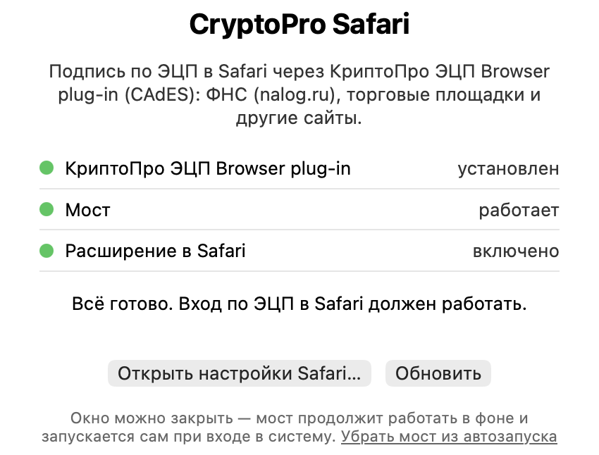
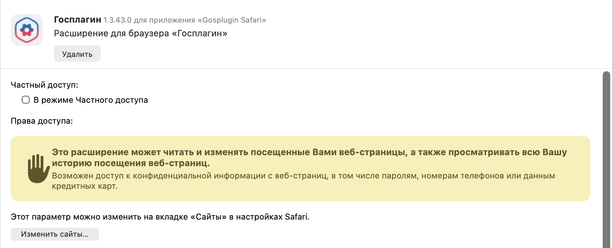

# Госуслуги, Диадок и ФНС по ЭЦП в Safari (macOS)

Три отдельных приложения для macOS, с которыми электронная подпись работает **в Safari** —
не только для **входа** на сайт, но и для **подписания документов**: заявлений на Госуслугах,
документов в Диадоке и других сервисах Контура, в личном кабинете ФНС (nalog.ru) и на любых
сайтах с КриптоПро ЭЦП Browser plug-in.

| Приложение | Что умеет в Safari | Нужен плагин |
|---|---|---|
| **Gosplugin Safari** | Госуслуги (gosuslugi.ru, esia.gosuslugi.ru): вход по ЭЦП и подписание заявлений и документов | Госплагин |
| **Kontur Safari** | Диадок, Контур.Крипто и другие сервисы Контура: вход по сертификату, подписание и проверка документов | Контур.Плагин |
| **CryptoPro Safari** | Сайты с КриптоПро ЭЦП Browser plug-in (CAdES): личный кабинет ФНС (nalog.ru), торговые площадки, порталы УЦ и др. | КриптоПро ЭЦП Browser plug-in |

**Теги:** Госуслуги · ЕСИА · Диадок · Контур · ФНС · nalog.ru · Госплагин · Контур.Плагин · КриптоПро · КриптоПро ЭЦП Browser plug-in · CAdES · ЭЦП · КЭП · электронная подпись · подпись документов · вход по ЭЦП · Safari · macOS · Mac · Рутокен · JaCarta

Ставьте одно, два или все три — они независимы. Внутри каждого: Safari-версия официального расширения
и встроенный мост к официальному плагину.

<p align="center"></p>

> Проект не связан с Ростелекомом, Минцифры, СКБ Контур или КриптоПро. Расширения Госплагина, Контура и КриптоПро
> принадлежат их правообладателям; здесь они лежат в изменённом виде только для работы в Safari.

## Что нужно заранее

| Компонент | Где взять |
|---|---|
| macOS 12+ и Safari 16+ (Apple Silicon или Intel) | — |
| **КриптоПро CSP 5.0** для macOS с действующей лицензией | [cryptopro.ru — загрузка КриптоПро CSP](https://www.cryptopro.ru/products/csp/downloads) (нужна бесплатная регистрация; лицензию — у КриптоПро, партнёров или в вашем удостоверяющем центре) |
| **Госплагин** — для Gosplugin Safari | [gosuslugi.ru/landing/gosplugin](https://www.gosuslugi.ru/landing/gosplugin) · [прямая ссылка на установщик для macOS](https://gu-st.ru/content/Gosplugin/Gosplugin_MacOS_Installer.pkg) |
| **Контур.Плагин** — для Kontur Safari | [install.kontur.ru](https://install.kontur.ru) — мастер настройки рабочего места Контура |
| **КриптоПро ЭЦП Browser plug-in** — для CryptoPro Safari | [cryptopro.ru — ЭЦП Browser plug-in](https://www.cryptopro.ru/products/cades/plugin) · [установщик](https://www.cryptopro.ru/products/cades/plugin/get_2_0) (расширение КриптоПро для Safari из установщика ставить не нужно — в новых Safari оно не появляется) |
| Носитель с вашей ЭЦП (Рутокен, JaCarta и т. п.) | драйвер обычно не нужен — КриптоПро работает с ним напрямую |
| **Xcode** — только для варианта 1 (подпись своим сертификатом) | [App Store](https://apps.apple.com/app/xcode/id497799835) |

Chrome не нужен: плагины ставятся обычными установщиками для macOS.

## Установка

1. Скачайте **`ESign-Safari.dmg`** со страницы [**Releases**](../../releases/latest).
2. Откройте его и перетащите нужные приложения в папку **«Программы»**.
   Делайте это **до** первого запуска: приложение запоминает, откуда запускать фоновый мост.
3. Приложения не подписаны. Выберите один из вариантов:
   - **[Вариант 1. Подписать своим сертификатом](#вариант-1-подписать-своим-сертификатом)** — один раз,
     и Safari больше ничего не спрашивает. Нужен Xcode, чтобы получить бесплатный сертификат;
     после этого его можно удалить.
   - **[Вариант 2. Без подписи](#вариант-2-без-подписи-через-меню-разработчика-safari)** — ничего ставить
     не нужно, но после **каждого** перезапуска Safari придётся ставить одну галочку.
4. Запустите приложение из «Программ». Откроется окно состояния:

   <p align="center">&nbsp;&nbsp;</p>
   <p align="center"></p>

5. Нажмите **«Открыть настройки Safari…»**. В списке слева поставьте галочку у расширения
   (Госплагин, Контур.Расширение или CryptoPro Safari Extension), затем **«Изменить сайты…» → Разрешить**:

   <p align="center"></p>

6. Перезапустите Safari (Cmd+Q) и входите по ЭЦП как обычно.

Когда в окне приложения все три пункта зелёные — всё готово. Окно можно закрыть: мост работает
в фоне и сам запускается при входе в систему. Окно можно открыть снова в любой момент — просто
запустите приложение ещё раз.

## Обновление

1. Закройте Safari (Cmd+Q).
2. Скачайте новый `ESign-Safari.dmg` и перетащите приложение в «Программы» с заменой.
3. Если пользуетесь вариантом 1 — сразу подпишите заново (шаг 2 варианта 1).
4. Откройте Safari и проверьте, что расширение включено (Настройки → Расширения).

Мост сам перезапустится на новой версии. Если обновлять при открытом Safari, он может решить,
что расширение удалено, и выключить его — тогда перезапустите Safari и включите расширение снова.

## Вариант 1. Подписать своим сертификатом

Safari без вопросов загружает расширения из приложений, подписанных сертификатом разработчика Apple.
Подойдёт бесплатный Apple ID — платная подписка не нужна. Сертификат выдаётся через Xcode,
поэтому его придётся поставить один раз (из App Store).

### 1. Получите сертификат Apple Development

1. Установите **Xcode** из App Store, откройте его и примите лицензию.
2. **Xcode → Settings → Accounts → «+» → Apple ID** — войдите своим Apple ID.
3. Выберите Apple ID → **Manage Certificates… → «+» → Apple Development**.

Проверьте в Терминале:

```bash
security find-identity -v -p codesigning
```

Должна быть строка `"Apple Development: ваш@email (XXXXXXXXXX)"`.

> Xcode нужен только для того, чтобы получить сертификат. Сертификат хранится в связке ключей,
> поэтому после этого шага Xcode можно удалить (освободится 10+ ГБ) — подписывать приложения
> он больше не нужен. Понадобится снова только через год, чтобы выпустить новый сертификат.

> Если сертификат виден только в `security find-identity -p codesigning` (без `-v`), не хватает
> промежуточного сертификата Apple. Установите его и проверьте снова:
>
> ```bash
> curl -fLO https://www.apple.com/certificateauthority/AppleWWDRCAG3.cer
> security import AppleWWDRCAG3.cer -k ~/Library/Keychains/login.keychain-db
> ```

### 2. Подпишите приложение

В Терминале (команда подпишет те из приложений, что лежат в «Программах»):

```bash
cd /Applications
for APP in "Gosplugin Safari.app" "Kontur Safari.app" "CryptoPro Safari.app"; do
  [ -d "$APP" ] || continue
  xattr -cr "$APP"
  codesign --force --sign "Apple Development" --preserve-metadata=entitlements --options runtime "$APP"/Contents/PlugIns/*.appex
  codesign --force --sign "Apple Development" --preserve-metadata=entitlements --options runtime "$APP"
  codesign --verify --deep --strict "$APP" && echo "$APP: подписано"
done
```

Что делают команды: `xattr -cr` снимает пометку «скачано из интернета», затем подписывается
сначала расширение внутри приложения, потом само приложение — с сохранением их разрешений.

> При первой подписи macOS спросит: *«codesign хочет подписать с помощью ключа … в связке
> ключей»*. Введите пароль от Mac и нажмите **«Всегда разрешать»** (окно может появиться
> несколько раз). Пока окно не закрыто, команда в Терминале будет «висеть».

> Если сертификатов Apple Development несколько, `codesign` попросит уточнить: вместо
> `"Apple Development"` укажите полное имя из `security find-identity -v -p codesigning`.

Готово — запускайте приложение (шаг 4 установки). Сертификат действует год; когда истечёт,
создайте новый и повторите шаг 2.

## Вариант 2. Без подписи (через меню разработчика Safari)

Ничего, кроме самого приложения, не нужно. Минус: Safari сбрасывает разрешение при каждом
перезапуске, и галочку из шага 3 придётся ставить снова.

1. **Разрешите запуск приложения.** Оно не подписано, поэтому macOS его заблокирует. В Терминале:

   ```bash
   xattr -cr "/Applications/Gosplugin Safari.app" "/Applications/Kontur Safari.app" "/Applications/CryptoPro Safari.app" 2>/dev/null
   ```

   Без Терминала: попробуйте открыть приложение, затем **Системные настройки → Конфиденциальность
   и безопасность** → внизу «Приложение было заблокировано…» → **Всё равно открыть**.

2. **Включите меню «Разработка» в Safari:** Safari → Настройки → **Дополнения** →
   «Показывать функции для веб-разработчиков».

3. **Разрешите неподписанные расширения:** в строке меню **Разработка → Разрешить неподписанные
   расширения** и введите пароль Mac. Это нужно делать **после каждого перезапуска Safari**.

4. Дальше — шаги 4–6 установки: запустить приложение, включить расширение в настройках Safari,
   разрешить доступ к сайтам.

## Вариант 3. Собрать из исходников в Xcode

1. Скачайте репозиторий (**Code → Download ZIP** или `git clone`).
2. Откройте `Gosplugin Safari/Gosplugin Safari.xcodeproj`, `Kontur Safari/Kontur Safari.xcodeproj`
   или `CryptoPro Safari/CryptoPro Safari.xcodeproj`.
3. Слева нажмите на проект → **Signing & Capabilities**. Для **обеих** целей (приложение и Extension):
   **Automatically manage signing** включено, **Team** — ваша команда (Apple ID добавляется в
   Xcode → Settings → Accounts).
4. **Product → Archive → Distribute App → Custom → Copy App** — или просто **Run** (Cmd+R), затем
   **Product → Show Build Folder in Finder → Products** и перенесите `.app` в «Программы».

Если Xcode пишет, что bundle identifier занят (*«…cannot be registered to your development team»*):
проект → цель проекта (не приложения) → **Build Settings** → `NMA_BUNDLE_PREFIX` → замените
`local.safaricrypto` на своё, например `com.ivanov.safaricrypto`.

## Частые вопросы

**Почему вход по ЭЦП на Госуслугах не работает в Safari на Mac?**
Госплагин официально поддерживает только Chrome, Firefox, Яндекс.Браузер и другие браузеры на
Chromium: его расширения для Safari нет. Gosplugin Safari добавляет такое расширение и связывает
его с установленным Госплагином — вход и подпись на Госуслугах начинают работать в Safari.

**Можно ли подписывать документы на Госуслугах в Safari, а не только входить?**
Да. Расширение передаёт Госплагину любые операции сайта: вход через ЕСИА, подписание заявлений
и документов электронной подписью.

**Диадок не видит сертификат в Safari. Что делать?**
Контур.Плагин тоже работает только в Chrome-подобных браузерах. Kontur Safari добавляет его
расширение в Safari: Диадок, Контур.Крипто и другие сервисы Контура видят сертификат, через
него можно войти, подписывать и проверять документы.

**Личный кабинет ФНС (nalog.ru) не видит ЭЦП в Safari. Что делать?**
nalog.ru и многие другие сайты (торговые площадки, порталы удостоверяющих центров) подписывают
через КриптоПро ЭЦП Browser plug-in. Его расширение для Safari в новых версиях Safari не
появляется в настройках. CryptoPro Safari добавляет в Safari официальное расширение КриптоПро
из Chrome Web Store и связывает его с установленным плагином — вход и подпись на nalog.ru работают.

**Нужен ли Chrome или Яндекс.Браузер?**
Нет. Нужны только КриптоПро CSP, сам Госплагин, Контур.Плагин или КриптоПро ЭЦП Browser plug-in
(обычные установщики для macOS)
и одно из приложений из этого репозитория.

**С какими носителями работает?**
С любыми, которые видит КриптоПро CSP: Рутокен, JaCarta, ESMART, контейнер на диске и т. п.

**Это безопасно?**
Приложения не отправляют данные никуда, кроме официального плагина на вашем Mac. Мост принимает
запросы только от своего расширения Safari — подробности в разделе «Безопасность».

**Работает на Apple Silicon (M1–M4) и Intel?**
Да, приложения универсальные. Нужны macOS 12+ и Safari 16+.

## Как это устроено

```
Сайт ──► Safari-расширение (официальное, с патчем)
           │ browser.runtime.sendNativeMessage
           ▼
         модуль расширения (SafariWebExtensionHandler.swift, в песочнице)
           │ HTTP 127.0.0.1:9105 (Госплагин) / 9106 (Контур) / 9107 (КриптоПро)
           ▼
         мост внутри приложения (AppDelegate.swift, фоновый процесс <приложение> --bridge)
           │ stdio, протокол Chrome Native Messaging
           ▼
         Госплагин / Контур.Плагин / ЭЦП Browser plug-in ──► КриптоПро CSP ──► носитель ЭЦП
```

Safari не даёт расширениям ни Chrome-овский native messaging, ни соединения с `localhost`, поэтому
расширение ходит через свой модуль, а модуль — в мост. Мост живёт в том же приложении: при обычном
запуске приложение показывает окно и ставит себя в автозапуск (`~/Library/LaunchAgents/…bridge.plist`)
с аргументом `--bridge`; в этом режиме оно работает без окна и держит мост.

Изменения в официальных расширениях:

- вызовы `chrome.runtime.connectNative` / `sendNativeMessage` заменены транспортом
  `extension/nt_shim.js`;
- Госплагин всегда использует native messaging (его WebSocket-режим в Safari не работает);
- Контур: убрана зависимость от `chrome.management` — в Safari его нет, и без патча расширение
  молча отбрасывает все запросы сайта;
- КриптоПро: `content.js` переведён со старого API Safari App Extension (`safari.extension.*`)
  на обычный `runtime.connect`, а `cadesplugin_api.js` на сайтах принимает для Safari только
  адрес `safari-extension://…` — поэтому сайту отдаётся условный адрес, который
  `extension/cades_safari_hook.js` подменяет на настоящий `safari-web-extension://…`;
- из manifest убраны поля Chrome Web Store.

### Безопасность

- Мост слушает только `127.0.0.1`.
- Принимает только `POST` с заголовком `X-NMA: 1` и **без** заголовка `Origin`. Сайт в браузере
  не может отправить такой запрос: нестандартный заголовок требует CORS-preflight, который мост
  отклоняет, а браузер всегда добавляет `Origin`.
- Каждое приложение запускает только свой плагин (белый список хостов), найденный по его
  официальному манифесту в `/Library/Google/Chrome/NativeMessagingHosts`.
- Содержимое запросов и подписей в логи не пишется.

## Если не работает

| Симптом | Что проверить |
|---|---|
| «Приложение повреждено» / «не удаётся проверить разработчика» | `xattr -cr` из варианта 1 или 2 |
| В окне приложения «плагин не установлен» | Установите Госплагин / Контур.Плагин / КриптоПро ЭЦП Browser plug-in |
| «Мост не отвечает» | Нажмите «Обновить»; лог `~/Library/Logs/<Приложение> bridge.log` |
| Перенесли приложение — мост перестал работать | Запустите приложение один раз из нового места |
| Расширение пропало из Safari после обновления | Закройте Safari (Cmd+Q), откройте и включите расширение снова — см. «Обновление» |
| Сразу после включения Mac сайт не видит плагин | Подождите минуту (мост запускается вместе с системой) и обновите страницу |
| Сайт не видит плагин | Расширение включено в Safari и ему разрешён доступ к сайту |
| Расширение пропадает после перезапуска Safari | Приложение не подписано — вариант 1 или галочка из варианта 2 |
| Ошибка «Отсутствует лицензия» | Лицензия КриптоПро: `/opt/cprocsp/sbin/cpconfig -license -view` |
| Сертификат не виден | `/opt/cprocsp/bin/csptest -keyset -enum_cont -fqcn -verifyc` |

Лог модуля расширения: `~/Library/Containers/<bundle id>.Extension/Data/nma_diag.log`.

## Удаление

В окне приложения нажмите **«Убрать мост из автозапуска»**, затем удалите приложение.
Расширение пропадёт из Safari вместе с ним.

## Для сопровождающих

Пересоздать проекты из свежих расширений Chrome Web Store:

```bash
python3 tools/generate_projects.py          # все
python3 tools/generate_projects.py kontur   # один
```

Код приложения — в `templates/`, транспорт — в `extension/nt_shim.js`, патчи расширений —
в `tools/prepare_extension.py`.

Собрать релиз — DMG (без подписи, universal; нужен `python3 -m pip install --user dmgbuild`):

```bash
python3 tools/build_release.py              # -> build/release/ESign-Safari.dmg
```

## Лицензия

Код этого репозитория (`templates/`, `extension/`, `tools/`) — MIT, см. `LICENSE`.
Расширения, Госплагин, Контур.Плагин, КриптоПро ЭЦП Browser plug-in и КриптоПро CSP принадлежат их правообладателям.
